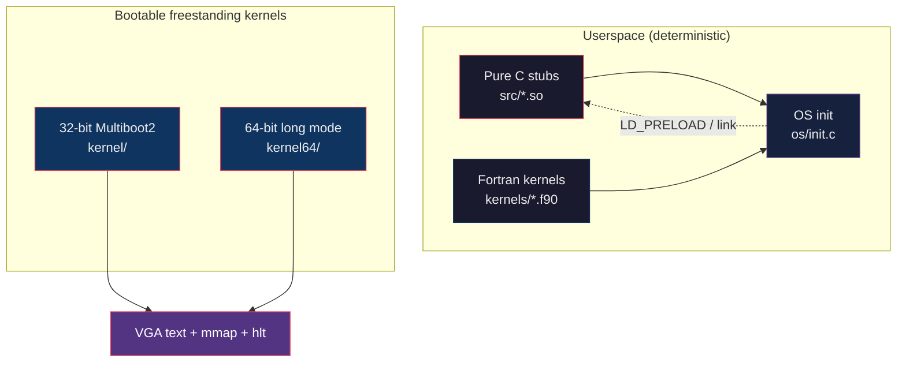
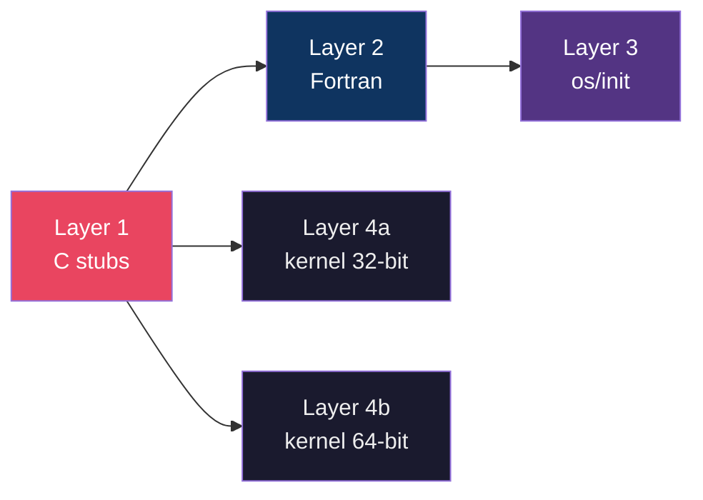
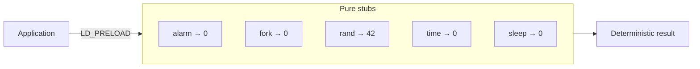
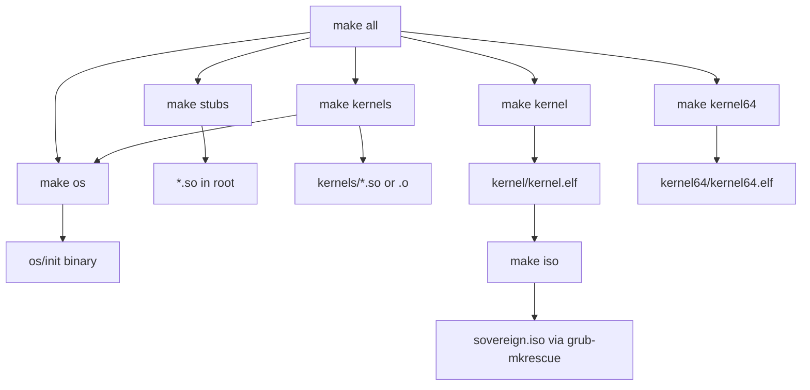
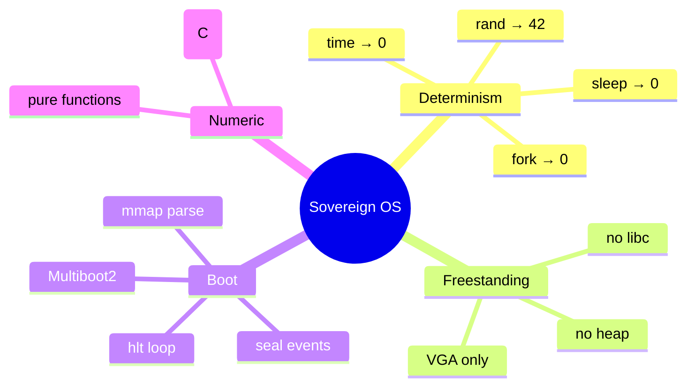

# preeny-sovereign

**Sovereign OS** — pure, deterministic, freestanding, bootable kernel.

No libc. No heap. No interrupts beyond halt. No non-deterministic time, random, or process creation.

---

## Architecture overview



---

## Layer stack

| Layer | Path | Role | Dependencies |
|-------|------|------|--------------|
| **1. Pure C stubs** | `src/` | Constant replacements for classic `LD_PRELOAD` hooks | none (shared objects) |
| **2. Fortran kernels** | `kernels/` | Pure `BIND(C)` numeric substrate | gfortran |
| **3. Userspace init** | `os/` | Process-1 style runner on pure stubs | stubs + Fortran |
| **4a. 32-bit kernel** | `kernel/` | Multiboot2 freestanding, VGA, mmap parse, seal, `hlt` | Multiboot2 bootloader |
| **4b. 64-bit kernel** | `kernel64/` | Long-mode switch, identity map, same pure seals | Multiboot2 + paging |



---

## Boot path (32-bit & 64-bit)

```mermaid
sequenceDiagram
    participant BIOS as BIOS / QEMU
    participant GRUB as Multiboot2 loader
    participant BOOT as boot.S
    participant K as kernel_main
    participant VGA as VGA 0xB8000

    BIOS->>GRUB: load kernel.elf
    GRUB->>BOOT: jump (magic + MBI ptr)
    Note over BOOT: 32-bit: direct entry<br/>64-bit: page tables, GDT, EFER.LME, long mode
    BOOT->>K: kernel_main(mbi)
    K->>VGA: clear screen
    K->>VGA: [SEAL] sovereign_kernel_boot
    K->>K: parse Multiboot2 mmap (tag 6)
    K->>VGA: print addr / len / type per entry
    K->>VGA: [SEAL] sovereign_kernel_ready
    K->>K: for(;;) hlt
```

### 32-bit (`kernel/`)

| File | Purpose |
|------|---------|
| `kernel/boot.S` | Multiboot2 header + entry; passes info structure pointer to `kernel_main` |
| `kernel/kernel.c` | VGA text, Multiboot2 tag walker, memory map (type 6) parser, pure seal, `hlt` loop |
| `kernel/linker.ld` | Load at 1 MiB |

```bash
make kernel
qemu-system-i386 -kernel kernel/kernel.elf
```

### 64-bit (`kernel64/`)

Long-mode kernel: Multiboot2 entry in 32-bit, then switches to x86_64 (identity-mapped 2 MiB pages, GDT, EFER.LME, paging).

| File | Purpose |
|------|---------|
| `kernel64/boot.S` | Multiboot2 header, page tables, long-mode switch, MBI in `%rdi` |
| `kernel64/kernel.c` | Same VGA + memory map parser, 64-bit seals |
| `kernel64/linker.ld` | Load at 1 MiB |

```bash
make kernel64
qemu-system-x86_64 -kernel kernel64/kernel64.elf
```

Screen output includes the memory map (addresses, lengths, types) between the boot and ready seals, then pure `hlt`.

---

## Kernel boot flow (detail)

```mermaid
stateDiagram-v2
    [*] --> MultibootEntry: loader jumps
    MultibootEntry --> ModeSwitch: 64-bit only
    ModeSwitch --> KernelMain: long mode ready
    MultibootEntry --> KernelMain: 32-bit direct
    KernelMain --> ClearVGA
    ClearVGA --> SealBoot: sovereign_kernel_boot
    SealBoot --> ParseMMAP: tag type 6
    ParseMMAP --> PrintEntries: addr / len / type
    PrintEntries --> SealReady: sovereign_kernel_ready
    SealReady --> HaltLoop: for(;;) hlt
    HaltLoop --> HaltLoop
```



---

## Pure C stubs

Deterministic replacements for non-deterministic libc / syscall behaviour.

| Module | Symbol(s) | Behavior |
|--------|-----------|----------|
| `dealarm.so` | `alarm()` | → `0` |
| `defork.so` | `fork()` | → `0` |
| `deptrace.so` | `ptrace()` | → `0` |
| `derand.so` | `rand()` / `random()` | → `42` |
| `desigact.so` | `sigaction()` | → `0` |
| `desleep.so` | `sleep()` / `usleep()` / `nanosleep()` | → `0` |
| `deuid.so` | `getuid()` / `geteuid()` | → `0` |
| `detime.so` | `time()` / `gettimeofday()` | → `0` |
| `startstop.so` | (constructor) | `SIGSTOP` on load |



---

## Fortran kernels

Pure numeric substrate, `BIND(C)` callable from C.

| Symbol | Signature (concept) | Meaning |
|--------|---------------------|---------|
| `sovereign_rand` | `() → int` | always `42` |
| `sovereign_triangular` | `(n) → int` | `n(n+1)/2` |
| `sovereign_identity` | `(x) → double` | `x` |
| `sovereign_zero` | `() → double` | `0.0` |
| `sovereign_square` | `(x) → double` | `x²` |
| `sovereign_phi_scale` | `(x) → double` | `x / φ` |
| `sovereign_dot` | `(n, a, b) → double` | dot product |
| `sovereign_sum` | `(n, a) → double` | sum |
| `sovereign_fill` | `(n, a, val)` | constant fill |
| `sovereign_scale` | `(n, a, s)` | in-place scale |

```mermaid
flowchart TB
    C["C / os layer"] -->|BIND(C)| FK["Fortran kernels"]
    FK --> MATH["sovereign_math.f90<br/>scalar pure functions"]
    FK --> VEC["sovereign_vector.f90<br/>dot / sum / fill / scale"]
```

---

## Multiboot2 memory map types

Printed by the kernel during boot:

| Type | Name | Meaning |
|------|------|---------|
| 1 | `available` | Usable RAM |
| 2 | `reserved` | Reserved by firmware / hardware |
| 3 | `acpi_reclaim` | ACPI tables, reclaimable after parse |
| 4 | `acpi_nvs` | ACPI non-volatile storage |
| 5 | `bad` | Defective memory |
| other | `unknown` | Unrecognised |

---

## Build graph



### Full build

```bash
make              # stubs + kernels + os + kernel + kernel64
make kernel       # 32-bit freestanding kernel.elf
make kernel64     # 64-bit freestanding kernel64.elf
make iso          # sovereign.iso (grub-mkrescue)
```

**Requires:** `gcc`, `gfortran`, and (for ISO) `grub-mkrescue` / `xorriso`.

---

## Design invariants

| Invariant | Enforcement |
|-----------|-------------|
| No heap | No `malloc` / freestanding |
| No libc in kernel | Direct VGA + Multiboot structures only |
| Deterministic time | `detime` stub → 0; kernel has no clock |
| Deterministic random | `derand` / `sovereign_rand` → 42 |
| No process spawn | `defork` → 0 |
| Halt only | Kernel ends in `for (;;) hlt` |
| Sealed boot | Explicit `[SEAL]` markers on VGA |



---

## License

C stubs derived from [zardus/preeny](https://github.com/zardus/preeny) (BSD-2-Clause).  
Fortran kernels, userspace init, and freestanding kernels are original sovereign pure code, provided as-is for deterministic environments.

---

## Further reading

- [Architecture notes](docs/ARCHITECTURE.md) — expanded diagrams and component tables
