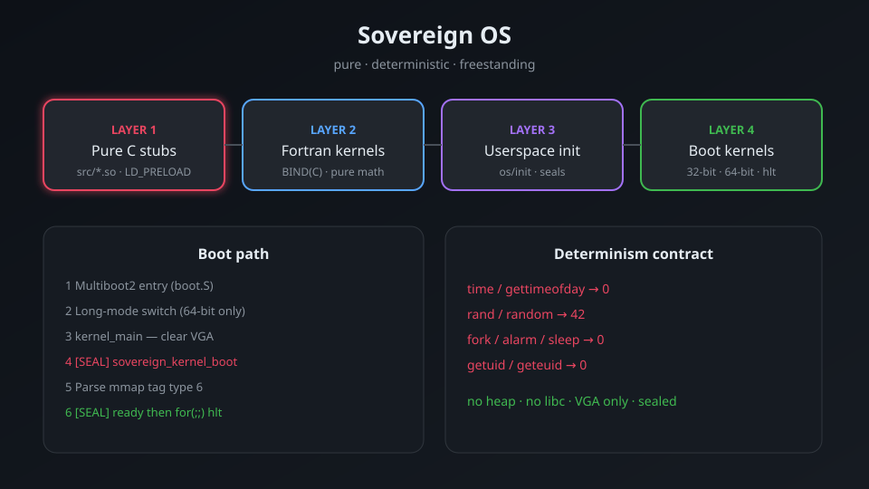
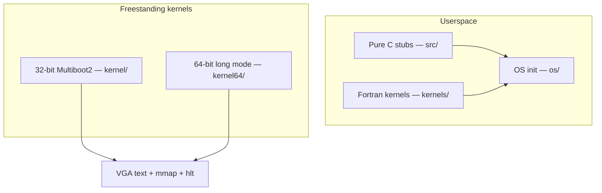
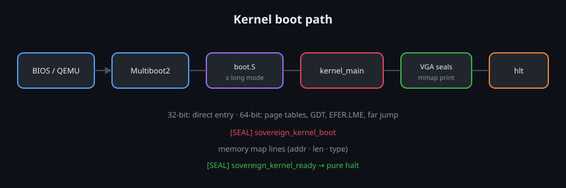
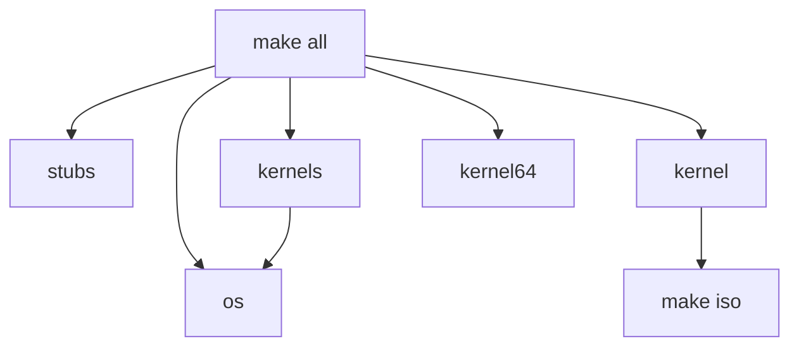

# preeny-sovereign

**Sovereign OS** — pure, deterministic, freestanding, bootable kernel.

No libc. No heap. No interrupts beyond halt. No non-deterministic time, random, or process creation.

---

## System map



---

## Architecture



**Layers**

1. **Pure C stubs** (`src/`) — constant replacements for classic `LD_PRELOAD` hooks  
2. **Fortran kernels** (`kernels/`) — pure `BIND(C)` numeric substrate  
3. **Userspace init** (`os/`) — process-1 style runner on the pure stubs  
4. **Bootable kernels** — Multiboot2 freestanding (32-bit and 64-bit): VGA, memory map, seal, `hlt`

---

## Boot path



```mermaid
sequenceDiagram
    participant BIOS as BIOS / QEMU
    participant GRUB as Multiboot2
    participant BOOT as boot.S
    participant K as kernel_main
    participant VGA as VGA

    BIOS->>GRUB: load kernel.elf
    GRUB->>BOOT: jump (magic + MBI)
    Note over BOOT: 32-bit direct / 64-bit long-mode switch
    BOOT->>K: kernel_main(mbi)
    K->>VGA: clear + SEAL boot
    K->>K: parse mmap tag 6
    K->>VGA: print map + SEAL ready
    K->>K: for(;;) hlt
```

### 32-bit (`kernel/`)

- `boot.S` — Multiboot2 header + entry; passes info pointer to `kernel_main`
- `kernel.c` — VGA text, Multiboot2 tag walker, memory map parser, seals, `hlt`
- `linker.ld` — load at 1 MiB

```bash
make kernel
qemu-system-i386 -kernel kernel/kernel.elf
```

### 64-bit (`kernel64/`)

Long-mode: Multiboot2 entry in 32-bit, then identity-mapped 2 MiB pages, GDT, EFER.LME, paging. MBI in `%rdi`.

```bash
make kernel64
qemu-system-x86_64 -kernel kernel64/kernel64.elf
```

---

## Pure C stubs

Deterministic replacements for non-deterministic libc behaviour.

| Module | Behavior |
| --- | --- |
| `dealarm.so` | `alarm` returns 0 |
| `defork.so` | `fork` returns 0 |
| `deptrace.so` | `ptrace` returns 0 |
| `derand.so` | `rand` / `random` return 42 |
| `desigact.so` | `sigaction` returns 0 |
| `desleep.so` | `sleep` / `usleep` / `nanosleep` return 0 |
| `deuid.so` | `getuid` / `geteuid` return 0 |
| `detime.so` | `time` / `gettimeofday` return 0 |
| `startstop.so` | raises SIGSTOP on load |

---

## Fortran kernels

Pure numeric substrate, callable from C via `BIND(C)`.

- **Scalars:** `sovereign_rand` (42), `triangular`, `identity`, `zero`, `square`, `phi_scale`
- **Vectors:** `sovereign_dot`, `sum`, `fill`, `scale`

Declared in `os/sovereign.h`.

---

## Build



```bash
make              # stubs + kernels + os + kernel + kernel64
make kernel       # 32-bit kernel.elf
make kernel64     # 64-bit kernel64.elf
make iso          # sovereign.iso (grub-mkrescue)
```

Requires `gcc`, `gfortran`, and for ISO: `grub-mkrescue` / `xorriso`.

---

## Design rules

- No heap, no libc in the kernel  
- Time and random are fixed (0 and 42)  
- No process spawn (`fork` → 0)  
- Kernel ends in `for (;;) hlt`  
- Boot progress only via explicit `[SEAL]` markers on VGA  

---

## License

C stubs derived from [zardus/preeny](https://github.com/zardus/preeny) (BSD-2-Clause).  
Fortran kernels, userspace init, and freestanding kernels are original sovereign code, as-is for deterministic environments.

More detail: [docs/ARCHITECTURE.md](docs/ARCHITECTURE.md)
