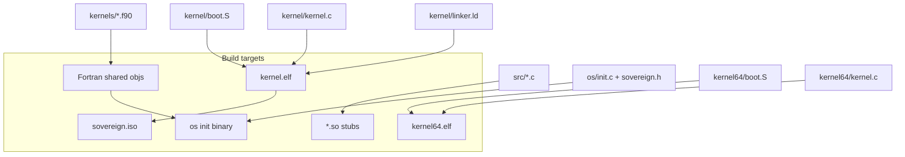
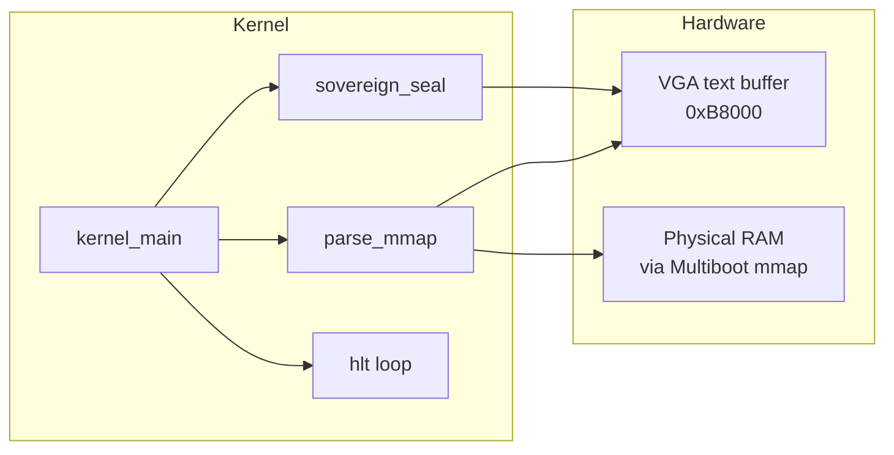
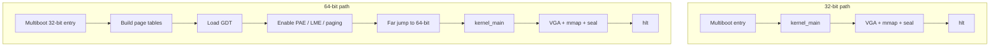

# preeny-sovereign — Architecture

Visual and tabular reference for the Sovereign OS stack.

---

## System map (SVG)

```svg
<svg xmlns="http://www.w3.org/2000/svg" viewBox="0 0 800 420" font-family="system-ui,sans-serif">
  <rect width="800" height="420" fill="#0d1117"/>
  <!-- Title -->
  <text x="400" y="36" text-anchor="middle" fill="#e6edf3" font-size="20" font-weight="700">Sovereign OS — System Map</text>

  <!-- Layer boxes -->
  <rect x="40" y="60" width="160" height="70" rx="8" fill="#21262d" stroke="#e94560" stroke-width="2"/>
  <text x="120" y="90" text-anchor="middle" fill="#e94560" font-size="12" font-weight="600">Layer 1</text>
  <text x="120" y="110" text-anchor="middle" fill="#e6edf3" font-size="13">Pure C stubs</text>
  <text x="120" y="126" text-anchor="middle" fill="#8b949e" font-size="11">src/*.so</text>

  <rect x="220" y="60" width="160" height="70" rx="8" fill="#21262d" stroke="#58a6ff" stroke-width="2"/>
  <text x="300" y="90" text-anchor="middle" fill="#58a6ff" font-size="12" font-weight="600">Layer 2</text>
  <text x="300" y="110" text-anchor="middle" fill="#e6edf3" font-size="13">Fortran kernels</text>
  <text x="300" y="126" text-anchor="middle" fill="#8b949e" font-size="11">kernels/*.f90</text>

  <rect x="400" y="60" width="160" height="70" rx="8" fill="#21262d" stroke="#a371f7" stroke-width="2"/>
  <text x="480" y="90" text-anchor="middle" fill="#a371f7" font-size="12" font-weight="600">Layer 3</text>
  <text x="480" y="110" text-anchor="middle" fill="#e6edf3" font-size="13">Userspace init</text>
  <text x="480" y="126" text-anchor="middle" fill="#8b949e" font-size="11">os/init.c</text>

  <rect x="580" y="60" width="180" height="70" rx="8" fill="#21262d" stroke="#3fb950" stroke-width="2"/>
  <text x="670" y="90" text-anchor="middle" fill="#3fb950" font-size="12" font-weight="600">Layer 4</text>
  <text x="670" y="110" text-anchor="middle" fill="#e6edf3" font-size="13">Bootable kernels</text>
  <text x="670" y="126" text-anchor="middle" fill="#8b949e" font-size="11">kernel / kernel64</text>

  <!-- Arrows layer 1-3 -->
  <path d="M200 95 H220" stroke="#8b949e" stroke-width="2" marker-end="url(#arrow)"/>
  <path d="M380 95 H400" stroke="#8b949e" stroke-width="2"/>

  <!-- Kernel detail -->
  <rect x="80" y="180" width="280" height="200" rx="10" fill="#161b22" stroke="#30363d" stroke-width="1"/>
  <text x="220" y="208" text-anchor="middle" fill="#e6edf3" font-size="14" font-weight="600">Freestanding kernel path</text>
  <text x="100" y="240" fill="#8b949e" font-size="12">1. Multiboot2 entry (boot.S)</text>
  <text x="100" y="262" fill="#8b949e" font-size="12">2. Optional long-mode switch (64-bit)</text>
  <text x="100" y="284" fill="#8b949e" font-size="12">3. kernel_main(mbi)</text>
  <text x="100" y="306" fill="#8b949e" font-size="12">4. VGA clear + [SEAL] boot</text>
  <text x="100" y="328" fill="#8b949e" font-size="12">5. Parse mmap tag type 6</text>
  <text x="100" y="350" fill="#8b949e" font-size="12">6. [SEAL] ready → hlt loop</text>

  <rect x="400" y="180" width="320" height="200" rx="10" fill="#161b22" stroke="#30363d" stroke-width="1"/>
  <text x="560" y="208" text-anchor="middle" fill="#e6edf3" font-size="14" font-weight="600">Determinism contract</text>
  <text x="420" y="240" fill="#e94560" font-size="12">time / gettimeofday → 0</text>
  <text x="420" y="262" fill="#e94560" font-size="12">rand / random → 42</text>
  <text x="420" y="284" fill="#e94560" font-size="12">fork → 0 · alarm → 0</text>
  <text x="420" y="306" fill="#e94560" font-size="12">sleep / usleep / nanosleep → 0</text>
  <text x="420" y="328" fill="#e94560" font-size="12">getuid / geteuid → 0</text>
  <text x="420" y="350" fill="#3fb950" font-size="12">no heap · no libc in kernel · seal only</text>

  <defs>
    <marker id="arrow" markerWidth="8" markerHeight="8" refX="6" refY="3" orient="auto">
      <path d="M0,0 L6,3 L0,6" fill="#8b949e"/>
    </marker>
  </defs>
</svg>
```

---

## Component dependency graph



---

## Directory layout

| Path | Type | Description |
|------|------|-------------|
| `src/` | C | Pure deterministic stubs (`dealarm`, `defork`, `derand`, …) |
| `kernels/` | Fortran 2008 | `sovereign_math.f90`, `sovereign_vector.f90` |
| `os/` | C | `init.c`, `sovereign.h` contracts |
| `kernel/` | ASM + C | 32-bit Multiboot2 freestanding kernel |
| `kernel64/` | ASM + C | 64-bit long-mode freestanding kernel |
| `docs/` | Markdown + SVG | Architecture visuals |
| `Makefile` | Make | Top-level orchestration |

---

## Kernel memory & I/O model



| Address / resource | Use in sovereign kernel |
|--------------------|-------------------------|
| `0xB8000` | VGA text mode (80×25) |
| Multiboot2 info | Passed from boot.S; total size + tags |
| Tag type 6 | Memory map entries (`addr`, `len`, `type`) |
| No heap | Stack only; static VGA pointer |

---

## 32-bit vs 64-bit boot comparison

| Step | 32-bit (`kernel/`) | 64-bit (`kernel64/`) |
|------|--------------------|----------------------|
| Entry | Multiboot2 → 32-bit protected mode | Multiboot2 → 32-bit, then switch |
| Paging | Not enabled by kernel | Identity-map 2 MiB pages |
| GDT | Minimal / existing | Explicit GDT for long mode |
| Long mode | N/A | Set EFER.LME, CR0.PG, far jump |
| MBI argument | Stack / register convention | `%rdi` |
| `kernel_main` | Same VGA + mmap logic | Same logic, 64-bit pointers |
| Terminal state | `hlt` loop | `hlt` loop |



---

## Stub → contract mapping

| Stub module | Overrides | Sovereign contract (`sovereign.h`) |
|-------------|-----------|-------------------------------------|
| `dealarm.c` | `alarm` | always 0 |
| `defork.c` | `fork` | always 0 |
| `deptrace.c` | `ptrace` | always 0 |
| `derand.c` | `rand`, `random` | always 42 |
| `desigact.c` | `sigaction` | always 0 |
| `desleep.c` | `sleep`, `usleep`, `nanosleep` | always 0 |
| `detime.c` | `time`, `gettimeofday` | always 0 |
| `deuid.c` | `getuid`, `geteuid` | always 0 |
| `startstop.c` | constructor | raise SIGSTOP |

---

## Fortran numeric surface

| Group | Symbols | Role |
|-------|---------|------|
| Scalar pure | `sovereign_rand`, `triangular`, `identity`, `zero`, `square`, `phi_scale` | Deterministic scalars |
| Vector | `sovereign_dot`, `sum`, `fill`, `scale` | Dense vector ops |

All entry points use `BIND(C)` and are declared in `os/sovereign.h`.

---

## Seal protocol

```mermaid
sequenceDiagram
    participant K as Kernel
    participant V as VGA

    K->>V: clear 80×25
    K->>V: "[SEAL] sovereign_kernel_boot"
    K->>V: memory map lines
    K->>V: "[SEAL] sovereign_kernel_ready"
    Note over K: No further output; pure halt
```

Seals are the only intentional side-effect channel after boot. They mark irreversible progress in a deterministic environment (no wall clock, no random).

---

## Related

- Root [README.md](../README.md) — build commands and layer summary
- Upstream stub inspiration: [zardus/preeny](https://github.com/zardus/preeny)
