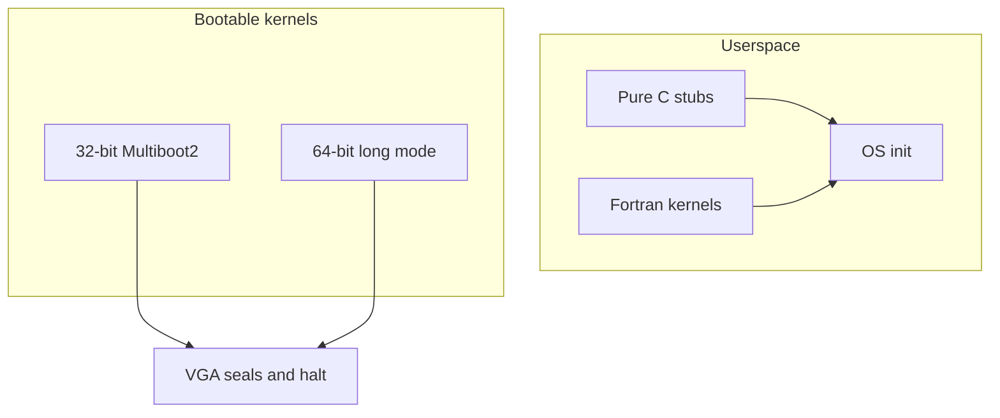
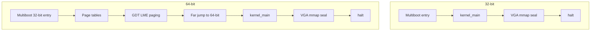
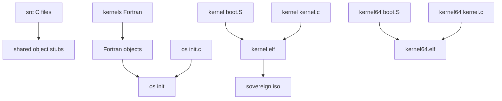
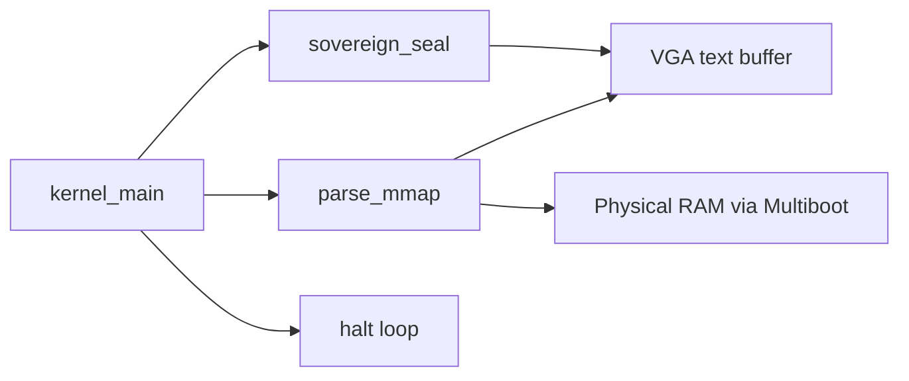
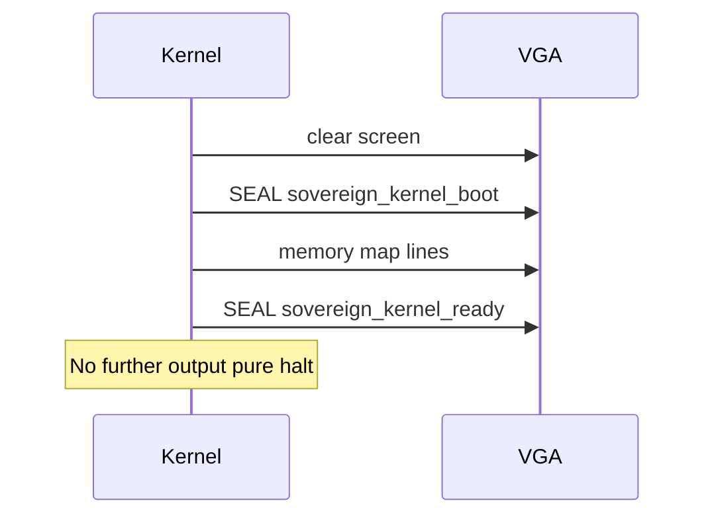

# Architecture

Visual reference for the Sovereign OS stack.

---

## System map

File: [images/system-map.svg](images/system-map.svg)

---

## Boot path

File: [images/boot-path.svg](images/boot-path.svg)

**32-bit** — Multiboot2 enters protected mode and jumps straight to kernel_main.  
**64-bit** — same entry, then builds identity maps, loads GDT, enables long mode, then kernel_main with MBI in rdi.

Both paths clear VGA, emit SEAL sovereign_kernel_boot, walk Multiboot tag type 6, emit SEAL sovereign_kernel_ready, then halt forever.

---

## Component graph

**Layout**

- `src/` — pure deterministic C stubs  
- `kernels/` — Fortran 2008 math and vector kernels  
- `os/` — init and sovereign.h contracts  
- `kernel/` — 32-bit Multiboot2 freestanding kernel  
- `kernel64/` — 64-bit long-mode freestanding kernel  
- `docs/images/` — SVG assets  

---

## Memory and I/O

- **0xB8000** — VGA text 80 by 25  
- **Multiboot2 info** — total size and tags from boot.S  
- **Tag type 6** — memory map entries addr, len, type  
- **No heap** — stack only; static VGA pointer  

Mmap type names: available, reserved, acpi_reclaim, acpi_nvs, bad, unknown.

---

## Stubs and contracts

| Module | Behavior |
| --- | --- |
| dealarm.c | alarm returns 0 |
| defork.c | fork returns 0 |
| deptrace.c | ptrace returns 0 |
| derand.c | rand random return 42 |
| desigact.c | sigaction returns 0 |
| desleep.c | sleep usleep nanosleep return 0 |
| detime.c | time gettimeofday return 0 |
| deuid.c | getuid geteuid return 0 |
| startstop.c | SIGSTOP on load |

Fortran surface in sovereign.h: scalars rand, triangular, identity, zero, square, phi_scale; vectors dot, sum, fill, scale. All BIND(C).

---

## Seal protocol

Seals are the only intentional side-effect channel after boot. No wall clock, no random.

---

## Related

- [README](../README.md)  
- Upstream stubs: [zardus/preeny](https://github.com/zardus/preeny)
